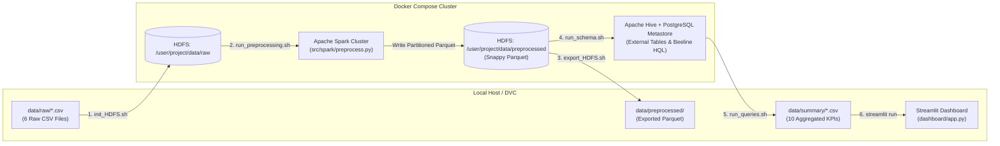

# Instacart Market Basket Analytics — End-to-End Big Data Pipeline

An end-to-end Big Data ETL, Data Warehousing, and Business Intelligence pipeline built on the **Hadoop Ecosystem** (**HDFS**, **Apache Spark**, and **Apache Hive**), containerized with **Docker Compose**, versioned with **DVC**, and visualized through an interactive **Streamlit & Plotly** dashboard.

---

## Project Overview

This project processes and analyzes the **Instacart Market Basket Analysis** dataset—comprising over **33.8 million** product-order records across **3.4 million** grocery orders from **206,209** users. 

By leveraging distributed storage and compute engines, the pipeline ingests raw relational CSVs into **Hadoop HDFS**, performs distributed cleaning, feature engineering, and schema enforcement in **PySpark**, exposes the transformed **Parquet** data lake as an external **Apache Hive** data warehouse, executes analytical SQL queries to extract key business metrics, and serves the insights through a 4-tab **Streamlit** analytics application.

---

## System Architecture & Pipeline Workflow



### Stage 1: Distributed Storage & Ingestion (`HDFS`)
* **Cluster**: `hadoop-namenode` and `hadoop-datanode` (Hadoop 3.2.1).
* **Ingestion (`src/HDFS/init_HDFS.sh`)**: Creates the `/user/project/data/raw` and `/user/project/data/preprocessed` directory namespaces in HDFS and uploads the 6 raw Instacart CSV files (`orders.csv`, `products.csv`, `aisles.csv`, `departments.csv`, `order_products__prior.csv`, `order_products__train.csv`).

### Stage 2: Distributed Preprocessing & Feature Engineering (`PySpark`)
* **Cluster**: `spark-master`, `spark-worker`, and `big_data_workspace` (`src/spark/preprocess.py`).
* **Strict Schema Enforcement**: Uses explicit `StructType` definitions for all 6 tables rather than `inferSchema` to prevent type drift.
* **RFC-4180 CSV Quoting**: Parses `products.csv` with `quote='"'` and `escape='"'` to properly handle product names containing embedded commas.
* **Data Cleaning & Feature Engineering**:
  * **First-Order Null Handling**: Fills structural nulls in `days_since_prior_order` (for `order_number == 1`) with `0.0` and adds an `is_first_order` boolean flag.
  * **30-Day Ceiling Detection**: Adds a `days_capped` boolean flag where `days_since_prior_order == 30.0` to mark censored intervals.
  * **Same-Day Reorders**: Adds a `same_day_reorder` flag (`days_since_prior_order == 0.0` and not first order).
  * **Temporal Enrichment**: Maps `order_dow` (0–6) to day names (`order_dow_label`) and bins `order_hour_of_day` into `late_night` (0–5), `morning` (6–9), `daytime` (10–16), and `evening` (17–23) via `hour_bin`.
  * **Category Sanitization**: Unifies `"missing"` and `"other"` placeholder labels in `aisles` and `departments` into an `"unknown"` sentinel category (`aisle_is_unknown`, `department_is_unknown`) and flags catalog-only items (`is_catalog_only_product`).
  * **Cold-Start & Outlier Annotation**: Computes per-order `basket_size`, flags orders exceeding 50 items (`is_large_basket`), and annotates products absent from the training set (`has_train_label`, `is_cold_start_product`).
* **Optimization & Storage**: Uses broadcast joins (`F.broadcast`) for dimension tables, validates foreign-key referential integrity and zero-null assertions, and writes **Snappy-compressed Parquet** files to HDFS (`orders` partitioned by `eval_set`, `order_products_prior` repartitioned into 200 buckets by `user_id`).

### Stage 3: Data Warehousing & Analytical Queries (`Apache Hive`)
* **Cluster**: `hive-server` (Hive 2.3.2) backed by `hive-metastore` (PostgreSQL).
* **Schema Deployment (`src/hive/create_schema.hql` & `run_schema.sh`)**: Creates the `instacart` database, registers 6 `EXTERNAL` Parquet tables pointing directly to `/user/project/data/preprocessed/*`, and runs `MSCK REPAIR TABLE orders` to discover the `eval_set` partitions.
* **KPI Extraction (`src/hive/extracted_queries.hql` & `run_queries.sh`)**: Executes 10 analytical queries over Beeline JDBC (`jdbc:hive2://localhost:10000/instacart`) and exports clean CSV summaries into `data/summary/`:
  1. `Busiest_Hours.csv` — Order volume across hours 0–23.
  2. `Busiest_Days.csv` — Order volume by day of the week (0–6).
  3. `Top_10_Products.csv` — Top 10 most frequently purchased products.
  4. `Top_Departments.csv` — Total purchase volume across all departments.
  5. `Reorder_Ratio_Dept.csv` — Repeat-purchase ratio per department.
  6. `Top_10_Aisles.csv` — Top 10 aisles by purchase volume.
  7. `Reorder_Ratio_Aisle.csv` — Repeat-purchase ratio per aisle.
  8. `Top_Reordered_Products.csv` — Top 10 products with the highest reorder counts.
  9. `Days_Since_Prior_Order.csv` — Distribution of days between consecutive orders (excluding first orders, isolating the `30+ (capped)` spike).
  10. `User_Order_Distribution.csv` — Engagement distribution of total prior orders per user across all 206,209 users.

### Stage 4: Interactive Analytics Dashboard (`Streamlit & Plotly`)
* **Application (`dashboard/app.py`)**: Reads the aggregated CSVs from `data/summary/` and renders an interactive 4-tab web dashboard:
  * **Temporal Analysis**: Line and bar charts showing hourly order peaks (10 AM – 3 PM) and weekend shopping surges.
  * **Product & Category**: Horizontal bar charts for top products/aisles and an interactive departmental volume Treemap.
  * **Reorder Behavior**: Habitual vs. exploratory purchasing comparisons across products, departments, and top/bottom aisles.
  * **User Engagement**: Reorder gap distributions (highlighting 7/14/21/28-day weekly cycles and the 30+ day cap) and user order-count distributions.

---

## Technology Stack

| Layer | Technology / Image | Purpose |
| :--- | :--- | :--- |
| **Container Orchestration** | Docker & Docker Compose v2 | Multi-container cluster deployment & networking |
| **Distributed File System** | Hadoop HDFS (`bde2020/hadoop-namenode:2.0.0-hadoop3.2.1-java8`) | Distributed storage for raw CSVs and Parquet tables |
| **Distributed Processing** | Apache Spark 3.2 / PySpark (`bde2020/spark-master:3.2.1-hadoop3.2`) | Distributed ETL, data cleaning, and feature engineering |
| **Interactive Workspace** | Jupyter PySpark (`jupyter/pyspark-notebook:spark-3.5.0`) | Custom workspace container (`Dockerfile`) |
| **Data Warehouse** | Apache Hive 2.3.2 (`bde2020/hive:2.3.2-postgresql-metastore`) | External SQL tables over HDFS Parquet & Beeline analytics |
| **Metastore DB** | PostgreSQL (`bde2020/hive-metastore-postgresql:2.3.0`) | Persistent Hive catalog metadata |
| **Data Version Control** | DVC (`raw.dvc`, `preprocessed.dvc`) | Tracking large raw and preprocessed datasets |
| **BI & Visualization** | Python, Streamlit, Plotly Express, Pandas | Interactive analytical web dashboard |
| **Build Automation** | GNU Make (`makefile`) & Bash Scripts | One-command pipeline orchestration |

---

## Repository Structure

```text
├── Dockerfile                         # Custom PySpark & Python workspace image definition
├── docker-compose.yml                 # 7-service Big Data cluster (HDFS, Spark, Hive, Workspace)
├── makefile                           # Automation targets (up, down, hdfs, spark, hive, pipeline)
├── requirements.txt                   # Python dependencies (PySpark, Streamlit, Plotly, DVC, Pandas)
├── ReadME.md                          # Project documentation and setup guide
├── dashboard/
│   └── app.py                         # Streamlit interactive analytics dashboard
├── data/
│   ├── raw/                           # Raw Instacart CSV datasets (tracked via raw.dvc)
│   ├── preprocessed/                  # Exported Snappy Parquet tables (tracked via preprocessed.dvc)
│   ├── summary/                       # 10 lightweight aggregated CSVs generated by Hive
│   ├── raw.dvc                        # DVC pointer for raw data
│   └── preprocessed.dvc               # DVC pointer for preprocessed Parquet data
├── src/
│   ├── HDFS/
│   │   ├── init_HDFS.sh               # Creates HDFS directories & uploads raw CSVs
│   │   └── export_HDFS.sh             # Exports preprocessed Parquet files from HDFS to local disk
│   ├── spark/
│   │   ├── preprocess.py              # PySpark ETL, cleaning, validation & Parquet writer
│   │   └── run_preprocessing.sh       # Health-checked Spark job submission script
│   └── hive/
│       ├── create_schema.hql          # DDL for External Parquet tables & partition repair
│       ├── extracted_queries.hql      # Reference SQL queries for business KPIs
│       ├── run_schema.sh              # Deploys Hive schema via Beeline
│       └── run_queries.sh             # Executes analytical queries & exports CSVs to data/summary/
└── report/
    ├── eda_report.md                  # In-depth Exploratory Data Analysis & data quality audit
    ├── query_analysis.md              # Validation & insight analysis of the 10 Hive queries
    ├── hive_runschema_analysis.md     # Troubleshooting notes for Hive Metastore configuration
    ├── erd.drawio.pdf                 # Entity-Relationship Diagram of the Instacart star schema
    ├── final_report.pdf               # Comprehensive final project report
    └── Instacart_Market_Basket_Analytics (1).pptx  # Project presentation slides
```

---

## How to Run the Project

### 1. Prerequisites
Ensure you have the following installed on your machine:
* **Docker** & **Docker Compose v2** (`docker compose version`)
* **GNU Make** (`make --version`)
* **Python 3.10+** & `pip` (for running the Streamlit dashboard locally and DVC)
* At least **6–8 GB of available RAM** for the Docker cluster.

### 2. Clone & Prepare the Dataset
Ensure the 6 raw Instacart CSV files are located in `data/raw/`:
* `aisles.csv`
* `departments.csv`
* `products.csv`
* `orders.csv`
* `order_products__prior.csv`
* `order_products__train.csv`

*(If using DVC with a configured remote, pull the tracked data with `dvc pull`).*

---

### 3. Running the Pipeline (Automated via `Makefile`)

The easiest way to manage the cluster and run the entire ETL pipeline is using the provided `makefile`:

#### **Step A: Start the Big Data Cluster**
Starts all 7 containers in detached mode, waits 20 seconds for initialization, and instructs the HDFS NameNode to leave safe mode:
```bash
make up
```

#### **Step B: Run the Full End-to-End Pipeline**
Executes HDFS ingestion, PySpark preprocessing, Parquet export to host, Hive schema registration, and Hive KPI query export in sequence:
```bash
make pipeline
```

*(Alternatively, you can run each stage individually using Make targets)*:
```bash
make hdfs          # Step 1: Upload raw CSVs from data/raw/ to HDFS
make spark         # Step 2: Run PySpark preprocessing job on the cluster
make export_hdfs   # Step 3: Export preprocessed Parquet files from HDFS to data/preprocessed/
make hive          # Step 4: Deploy Hive External Tables and export 10 KPI CSVs to data/summary/
```

---

### 4. Running the Pipeline (Manual Step-by-Step via Bash Scripts)

If you prefer executing each script directly without `make`:

```bash
# 1. Start the Docker Compose cluster and exit HDFS safe mode
docker compose up -d
sleep 20
docker exec -it hadoop-namenode hdfs dfsadmin -safemode leave

# 2. Initialize HDFS directories and upload raw CSVs
bash src/HDFS/init_HDFS.sh

# 3. Submit the PySpark preprocessing job (pass --build to rebuild workspace image if needed)
bash src/spark/run_preprocessing.sh

# 4. (Optional) Export preprocessed Parquet files from HDFS to local data/preprocessed/
bash src/HDFS/export_HDFS.sh

# 5. Deploy the Hive external schema over the HDFS Parquet files
bash src/hive/run_schema.sh

# 6. Run the 10 Hive analytical queries and export results to data/summary/*.csv
bash src/hive/run_queries.sh
```

---

### 5. Launch the Streamlit Analytics Dashboard

Once `data/summary/*.csv` files are populated (they are also pre-committed in the repository for immediate viewing), launch the dashboard locally:

```bash
# 1. Create and activate a Python virtual environment (or use existing ./venv)
python3 -m venv venv
source venv/bin/activate

# 2. Install required dependencies
pip install -r requirements.txt

# 3. Start the Streamlit server
streamlit run dashboard/app.py
```
Open your browser at **`http://localhost:8501`** to explore the dashboard.

---

## Cluster Web UIs & Exposed Ports

While the Docker Compose stack is running, you can monitor the cluster services at the following local ports:

| Service | Container Name | URL / Port | Description |
| :--- | :--- | :--- | :--- |
| **Streamlit Dashboard** | *(Host Process)* | `http://localhost:8501` | Interactive BI Analytics Dashboard |
| **HDFS NameNode UI** | `hadoop-namenode` | `http://localhost:9870` | Browse HDFS filesystem, DataNodes & cluster health |
| **HDFS IPC Port** | `hadoop-namenode` | `hdfs://localhost:9000` | Internal/External HDFS RPC endpoint |
| **Spark Master UI** | `spark-master` | `http://localhost:8080` | Monitor Spark workers, running apps & cluster resources |
| **Spark Application UI** | `big_data_workspace` | `http://localhost:4040` | Active Spark job DAGs, stages & executor metrics |
| **Jupyter Notebook** | `big_data_workspace` | `http://localhost:8888` | Interactive PySpark workspace container |
| **HiveServer2 Thrift** | `hive-server` | `localhost:10000` | JDBC endpoint (`jdbc:hive2://localhost:10000/instacart`) |

---

## Stopping & Cleaning Up

To pause the containers without losing HDFS or Metastore state:
```bash
make stop
# Resume later with:
make start
```

To tear down the entire cluster and remove associated Docker volumes (`namenode_data`):
```bash
make down
```
